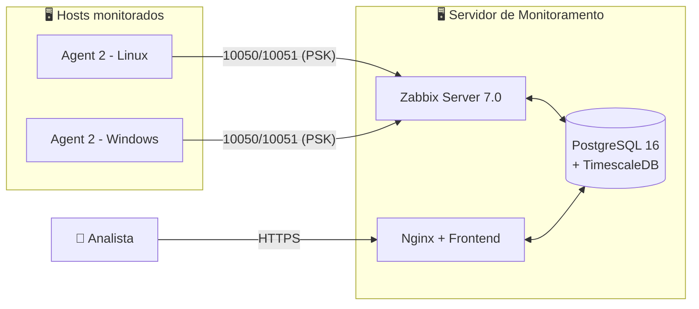

<h1 align="center">📡 Zabbix Monitoring</h1>

<p align="center">
  Monitoramento centralizado com Zabbix 7.0, automação do Agent e importação em massa de hosts via API.
</p>

<p align="center">
  
  
  
  
  
  
  
</p>

---

## 📑 Sumário

- [Sobre o projeto](#-sobre-o-projeto)
- [Stack do ambiente](#-stack-do-ambiente)
- [Arquitetura](#️-arquitetura)
- [Estrutura do repositório](#-estrutura-do-repositório)
- [Instalação do Zabbix Agent](#-instalação-do-zabbix-agent)
- [Importação/Exportação em massa](#-importaçãoexportação-em-massa)
- [Dashboards](#-dashboards)
- [Segurança aplicada](#-segurança-aplicada)
- [Troubleshooting](#-troubleshooting)
- [Entregas](#-entregas)
- [Autor](#-autor)

## 📌 Sobre o projeto

Em ambientes com muitos servidores e estações, cadastrar hosts manualmente é lento, propenso a erro e não escala. Este projeto entrega uma solução de monitoramento **padronizada, segura e reproduzível**:

- 🖥️ Zabbix Server 7.0 standalone, instalado 100% via CLI
- 🤖 Instalação do Agent automatizada por script (Linux e Windows)
- 📦 Exportação/importação em massa de hosts e templates
- 📊 Dashboards para visão operacional em tempo real
- 🔐 Comunicação criptografada com PSK

## 🧱 Stack do ambiente

| Item | Valor |
|------|-------|
| Sistema do servidor | Rocky Linux 9 |
| Banco de dados | PostgreSQL 16 + TimescaleDB |
| Frontend | Nginx + PHP-FPM |
| Coleta | Zabbix Agent 2 (ativo + passivo) |

## 🏗️ Arquitetura




## 📂 Estrutura do repositório

```text
.
├── .github/workflows/   # CI (ShellCheck)
├── docs/                # documentação técnica e imagens
├── scripts/
│   ├── agent/           # instalação automatizada do Agent
│   └── api/             # exportação/importação via API
├── templates/           # templates Zabbix customizados
└── exports/             # exemplos de exportação de hosts
```

## 🚀 Instalação do Zabbix Agent

### 🐧 Linux (automatizado)

```bash
git clone https://github.com/SEU_USUARIO/SEU_REPO.git
cd SEU_REPO/scripts/agent

chmod +x install_zabbix_agent.sh

# Instalação básica
sudo ./install_zabbix_agent.sh -s 192.0.2.10

# Com hostname definido e criptografia PSK
sudo ./install_zabbix_agent.sh -s 192.0.2.10 -n srv-001 -e
```

| Flag | Descrição |
|------|-----------|
| `-s` | IP/DNS do Zabbix Server (**obrigatório**) |
| `-n` | Hostname no Zabbix (padrão: hostname da máquina) |
| `-m` | HostMetadata para auto-registro (padrão: `linux`) |
| `-e` | Habilita criptografia PSK (gera a chave localmente) |
| `-h` | Ajuda |

### 🪟 Windows (CMD como Administrador)

```bat
msiexec /i zabbix_agent2-7.0.X-windows-amd64-openssl.msi /qn ^
  SERVER=192.0.2.10 SERVERACTIVE=192.0.2.10 HOSTNAME=ws-001
```

### ✅ Validação

```bash
systemctl status zabbix-agent2                # serviço ativo
ss -tlnp | grep 10050                         # porta de escuta
zabbix_get -s IP_DO_CLIENTE -k agent.ping     # (no servidor) deve retornar 1
```

## 📥 Importação/Exportação em massa

Usa a **API JSON-RPC** com token (*Users → API tokens*), sem senhas em script.

```bash
export ZBX_URL="https://zabbix.exemplo.local/api_jsonrpc.php"
export ZBX_TOKEN="seu_token_aqui"      # nunca versionar!

# Exportar hosts
./scripts/api/export_hosts.sh > exports/hosts.yaml

# Importar hosts (novo ambiente ou restauração)
./scripts/api/import_hosts.sh exports/hosts.yaml
```

Via interface: **Data collection → Hosts → Import** (ou **Templates → Import**) e selecione o arquivo de `exports/` ou `templates/`.

> 💡 Importe os **templates primeiro** e os hosts depois, para os vínculos resolverem corretamente.

## 📊 Dashboards

1. **Dashboards → Create dashboard**
2. Adicione widgets: *Problems*, *Top hosts by CPU*, *Graph* (memória/disco) e *Host availability*
3. Filtre por *Host groups* para separar ambientes e funções (servidores, estações, rede)

| Visão geral | Por host |
|:-----------:|:--------:|
|  |  |

## 🔐 Segurança aplicada

- ✅ Criptografia PSK entre Agent e Server
- ✅ Firewall liberando 10050/10051 apenas para as origens necessárias
- ✅ Token de API em vez de usuário/senha
- ✅ Frontend atrás de HTTPS
- ✅ Nenhum segredo versionado (`.gitignore`)

## 🧯 Troubleshooting

| Sintoma | Causa provável | Verificação |
|---------|----------------|-------------|
| Ícone ZBX vermelho | Firewall / porta 10050 bloqueada | `nc -zv IP 10050` |
| `Cannot connect to [[...]]` | `Server=` incorreto no agent | `/etc/zabbix/zabbix_agent2.conf` |
| Host não auto-registra | `ServerActive`/`HostMetadata` errados | `/var/log/zabbix/zabbix_agent2.log` |
| Erro de PSK | Identidade/chave divergentes | Compare com a aba *Encryption* do host |

Mais detalhes em [`docs/troubleshooting.md`](docs/troubleshooting.md).

## ✅ Entregas

- [x] Zabbix Server 7.0 em produção (Rocky Linux 9 + PostgreSQL 16 + TimescaleDB)
- [x] Automação da instalação do Agent (Linux e Windows)
- [x] Exportação/importação em massa de hosts e templates via API
- [x] Dashboards de visão operacional
- [x] Comunicação criptografada com PSK

## 🧰 Tecnologias

`Zabbix` · `Rocky Linux` · `PostgreSQL` · `TimescaleDB` · `Nginx` · `Bash` · `Mermaid` · `GitHub Actions`

## 👤 Autor

**Emerson Souza** | Infraestrutura

[](https://linkedin.com/in/SEU_PERFIL)
[](https://github.com/SEU_USUARIO)

## 📄 Licença

Distribuído sob a licença MIT.
